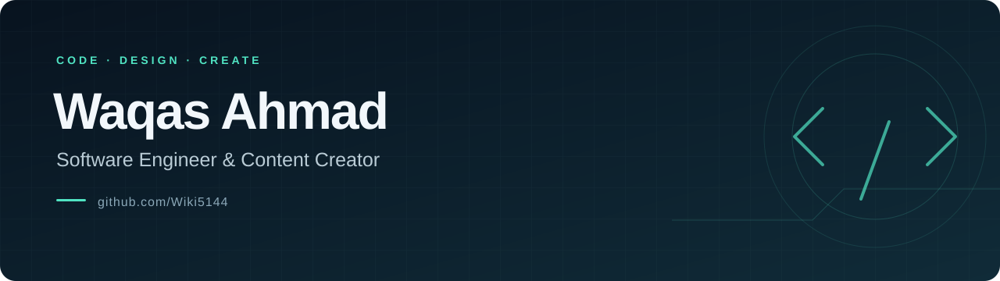

  <a href="https://waqas5144-portfolio-three.vercel.app/"><strong>Explore my portfolio ↗</strong></a>
  &nbsp; · &nbsp;
  <a href="https://waqas5144-portfolio-three.vercel.app/#contact">Get in touch</a>
  &nbsp; · &nbsp;
  <a href="https://www.dotera.co/">Dotera</a>

## Hello, I'm Waqas

I'm a software engineer and content creator working across web development, digital experiences, and creative content.

- **Build:** web applications with JavaScript, React, Next.js, and Node.js
- **Design:** responsive interfaces with a focus on clarity and usability
- **Create:** digital content that connects technology and communication

## Selected work

<table>
  <tr>
    <td width="50%" valign="top">
      <h3>Personal Portfolio</h3>
      
A home for my development work, creative projects, and ways to connect.

      
<strong>Next.js · React · Tailwind CSS</strong>

      <a href="https://waqas5144-portfolio-three.vercel.app/">Visit portfolio ↗</a>
    </td>
    <td width="50%" valign="top">
      <h3>Research Hub</h3>
      
My final-year project, featured in my portfolio.

      
<strong>Web application · Academic project</strong>

      <a href="https://reaserch-hub-fyp-2024.vercel.app/app/welcome">Explore project ↗</a>
    </td>
  </tr>
</table>

## Tools I work with

**Frontend** &nbsp; JavaScript · React · Next.js · Tailwind CSS  
**Backend** &nbsp; Node.js  
**Workflow** &nbsp; Git · GitHub · Vercel

## Beyond the code

My portfolio also features work connected with [Pixel Perfects](https://www.pxlperfects.com/), [Dotera](https://dotera.co/), [Coders Wire](https://coderswire.com/), and [Virtual Dive Studio](https://www.virtualdive.studio/).

---

Have a project in mind? <a href="https://waqas5144-portfolio-three.vercel.app/#contact"><strong>Let's connect.</strong></a>

